<h1 align="center">Volodymyr Borysenko</h1>

  Software Engineering + AI/ML | Data Science @ UC Berkeley | RISE Global Winner

---

### 👨‍💻 About

- 🔭 Building **TacticSquare** for UAV coordination simulation and **FireImpactology** for wildfire exposure analysis.
- 🎯 Focus: multi-agent RL, stochastic combat models, graph optimization, remote sensing.
- 🛰 Working with Sentinel-2 and ERA5 data, downscaled climate projections and geospatial pipelines.
- 🇺🇦 From Ukraine; my projects span heat risk, wildfire exposure and UAV coordination.
- 📈 Kaggle: [rank 10 of 600](https://www.kaggle.com/competitions/store-sales-time-series-forecasting/leaderboard) in Store Sales forecasting, top 1% in Housing Prices, 100+ [public notebooks](https://www.kaggle.com/volodymyrborysenko/code).

---

### 🚀 Selected projects

- **[Recount](https://github.com/VolodymyrLinuxovich/recount)** ([live demo](https://recount-nu.vercel.app)) - Cal Hacks 13.0 winner (Apify and Convex prizes), built solo: snap a hospital bill and it checks each charge against the hospital's published cash prices and California charity care law, then drafts the dispute or financial aid application. Prices for 340 of 470 California hospitals come from a public Apify Actor; Convex runs the backend.
- **[Waves](https://github.com/VolodymyrLinuxovich/mistral-waves)** ([live demo](https://waves-nine-gold.vercel.app)) - FastAPI heatwave map for Ukraine with deterministic personal-risk scoring and Mistral-generated bilingual action plans under privacy and medical-safety guardrails.
- **[heat-risk-cuda](https://github.com/VolodymyrLinuxovich/heat-risk-cuda)** - custom CUDA C++ kernels compiled at runtime with NVIDIA `cuda.core`, verified for exact parity with NumPy and PyTorch references (171 GPU tests) and benchmarked on a Tesla T4: a shared-memory tiled kernel cut end-to-end time 2.2× and runs about 5× faster than the PyTorch baseline.
- **[SwarmDAQ](https://github.com/VolodymyrLinuxovich/swarmdaq)** ([live demo](https://swarmdaq.vercel.app)) - performance exchange for AI agents built at WeaveHacks 2025: agents bid on tasks, a market maker routes work to the best swarm, and reputation updates after every run, with W&B Weave tracing and Redis memory.
- **[LargeVCModel](https://github.com/VolodymyrLinuxovich/largevcmodel)** - Next.js + PostgreSQL platform for relationship search, company research, investor-fit scoring and secure Google integrations.
- **[TacticSquare](https://isef.net/project/math037-uavs-in-ground-combat-stochastic-modelling)** - AI combat simulator for UAV coordination, route planning and attrition forecasts using RL, graph search and Bayesian Monte Carlo; field-tested in Ukraine with 10 divisions and backed by external funding.
- **[FireImpactology](https://www.spaceappschallenge.org/2023/find-a-team/fire-impactology/?tab=project)** - wildfire analytics pipeline: MODIS/VIIRS/Sentinel-2 + ERA5 + Gaussian plume to map PM2.5/PM10 and health risk.
- **[Schmidt DSE Climate Pipeline](https://github.com/VolodymyrLinuxovich/climate_data_pipeline)** - xarray and Dask workflows for downscaled CMIP6 analysis and National Park Service climate-risk maps at the [Eric and Wendy Schmidt Center for Data Science & Environment](https://dse.berkeley.edu/).
- **[DEMI](https://github.com/VolodymyrLinuxovich/demi)** - wearable prototype with gas sensors, microcontroller and CV backend that detects TVOC spikes and automatically triggers a deodorizing spray.

---

### 🌐 Open source

177 merged pull requests across 15 established open source projects. Top 5:

| Project | Merged | Highlights |
|---|:---:|---|
| **[All the Places](https://github.com/alltheplaces/alltheplaces)** | 156 | Added 108 spiders covering 2.8 million+ locations, including city tree registers for [Berlin](https://github.com/alltheplaces/alltheplaces/pull/20629), [Toronto](https://github.com/alltheplaces/alltheplaces/pull/20633) and [Amsterdam](https://github.com/alltheplaces/alltheplaces/pull/20690), [Royal Mail](https://github.com/alltheplaces/alltheplaces/pull/19405) and [NTT public telephones](https://github.com/alltheplaces/alltheplaces/pull/19475), and fixed existing spiders such as [Coles](https://github.com/alltheplaces/alltheplaces/pull/19272) |
| **[OWASP Java Encoder](https://github.com/OWASP/owasp-java-encoder)** | 5 | Added the new [`Encode.forJson`](https://github.com/OWASP/owasp-java-encoder/pull/151) API, [escaped DEL and C1 controls](https://github.com/OWASP/owasp-java-encoder/pull/166) in the JavaScript encoders, [added XML 1.1 tags and EL functions](https://github.com/OWASP/owasp-java-encoder/pull/168), [propagated the forUri deprecation](https://github.com/OWASP/owasp-java-encoder/pull/170) and [fixed OSGi import ranges](https://github.com/OWASP/owasp-java-encoder/pull/174) |
| **[PySAL](https://github.com/pysal)** | 3 | [Accepted libpysal `Graph` in `Gini_Spatial`](https://github.com/pysal/inequality/pull/125) with about 60x faster pair counting, plus fixes in [mgwr](https://github.com/pysal/mgwr/pull/173) and [segregation](https://github.com/pysal/segregation/pull/301) |
| **[Apify Crawlee](https://github.com/apify/crawlee)** | 2 | [Restored request queue counts after a restart](https://github.com/apify/crawlee/pull/4303) and [emptied an unopened inner queue on purge](https://github.com/apify/crawlee/pull/4394) |
| **[GeoPandas](https://github.com/geopandas/geopandas)** | 2 | [Made the explode index dtype consistent](https://github.com/geopandas/geopandas/pull/3871) across platforms and [removed a dead testing helper](https://github.com/geopandas/geopandas/pull/3869) |

Also merged in NVIDIA NeMo Curator, OWASP Dependency-Check, Kigali Sim, rioxarray, Dependency-Track and others. In review at [Apify SDK](https://github.com/apify/apify-sdk-js/pull/894), [OWASP ESAPI](https://github.com/ESAPI/esapi-java-legacy/pulls?q=is%3Apr+author%3AVolodymyrLinuxovich), [GeoPandas](https://github.com/geopandas/geopandas/pull/3879) and [Newton](https://github.com/newton-physics/newton/pull/4600).

---

### 🏅 Achievements

- **[RISE Global Winner](https://www.risefortheworld.org/global-winners/) (Schmidt Futures & Rhodes Trust), 2024**  
  Top 100 of 50,000+ from 170+ countries with scholarship and project funding.

- **[King Abdulaziz and Mawhiba Award](https://isef.net/project/math037-uavs-in-ground-combat-stochastic-modelling), 2024**  
  Top 10 of 1,500 finalists for a combat-operations simulator using Monte Carlo and cellular automata.

- **[Genius Olympiad Gold](https://man.gov.ua/about/news/vihovanci-man-peremogli-na-genius-olympiad) (Environmental Science), 2024**  
  "FireImpactology" for wildfire, air quality and health impact modeling.

- **[INFOMATRIX International Platinum Medal](https://kman.kyiv.ua/ua/Final-Mizhnarodnoho-konkursu-INFOMATRIX-2024), 2024**  
  1st place among 300 participants for advanced combat simulation with stochastic Lanchester models and RL-aided route planning.

- **All-Ukrainian Programming Cup, 3rd place and Jane Street Award, 2025**

- **[NASA Space Apps Challenge](https://www.spaceappschallenge.org/2023/find-a-team/fire-impactology/?tab=project), 2nd place in Ukraine, 2023**  
  FireImpactology wildfire and air quality pipeline.

- **[Venture and deployment](https://tumo.ai/teens/report)**  
  $50,000 raised to scale TacticSquare pilots with 10 divisions and international visibility.

---

### 🏆 Hackathons

- **Sundai Hackathon at RSI House, 1st place, 2026**  
  "[Redshift](https://github.com/VolodymyrLinuxovich/exo-referee)" ([live](https://redshift.egbe.app)), a referee for self-improving models that only promotes changes that hold up on 1,328 NASA Kepler host stars no agent ever sees.

- **Ramp Hackathon, 3rd place in the final, 2026**  
  "[Tickmark](https://github.com/VolodymyrLinuxovich/tickmark)" ([live](https://tickmark-eta.vercel.app)), which answers an auditor's year-end request list straight from Ramp records and hands back an evidence binder.

- **SF AI Research Hackathon, Google DeepMind award, 2026**  
  "[Spectre](https://github.com/VolodymyrLinuxovich/spectre)" ([live](https://spectre-referee.vercel.app)), a research agent swarm with a referee that catches fake gains in molecule identification from mass spectra.

- **[Cal Hacks 13.0](https://devpost.com/software/recount-spgda6), Apify and Convex prizes, 2026**  
  "[Recount](https://github.com/VolodymyrLinuxovich/recount)" ([live](https://recount-nu.vercel.app)), a hospital bill checker that catches overcharges and finds charity care patients qualify for. Built solo.

- **B@BHacks 2.0 by Blockchain@Berkeley, Silver Medal plus Gemini track and medal, 2026**  
  "[Highwater](https://github.com/VolodymyrLinuxovich/highwater)" ([live](https://highwater-tau.vercel.app)), live pricing for Gemini daily high temperature contracts across 49 US cities.

- **Agentic AI SF Hackathon, 1st place, 2026**  
  "[FireScout](https://github.com/VolodymyrLinuxovich/firescout)", a wildfire smoke agent that monitors any location and sends smoke risk updates. Built solo.

---

### 🧰 Tech stack

  
  
  

Core domains: CUDA and GPU computing, RL (DQN, PPO), multi-agent systems, Monte Carlo, stochastic processes, graph algorithms, geospatial and remote sensing (GeoPandas, Rasterio, rioxarray, GDAL), time series, simulation.

---

### 📊 Stats

  
  

  

---

### 🔗 Links

- Resume: [View PDF](https://drive.google.com/file/d/1-Te5vAf4e73Ow701r_0d1FXeJbv-WRBA/view?usp=sharing)
- Website: [vborysenko.com](https://vborysenko.com)
- LinkedIn: [Volodymyr Borysenko](https://www.linkedin.com/in/volodymyr-borysenkooo)
- Email: volodymyr_borysenko@berkeley.edu
